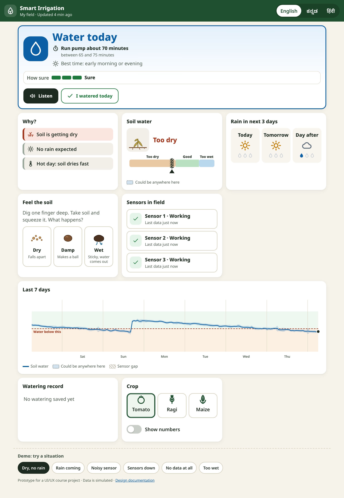
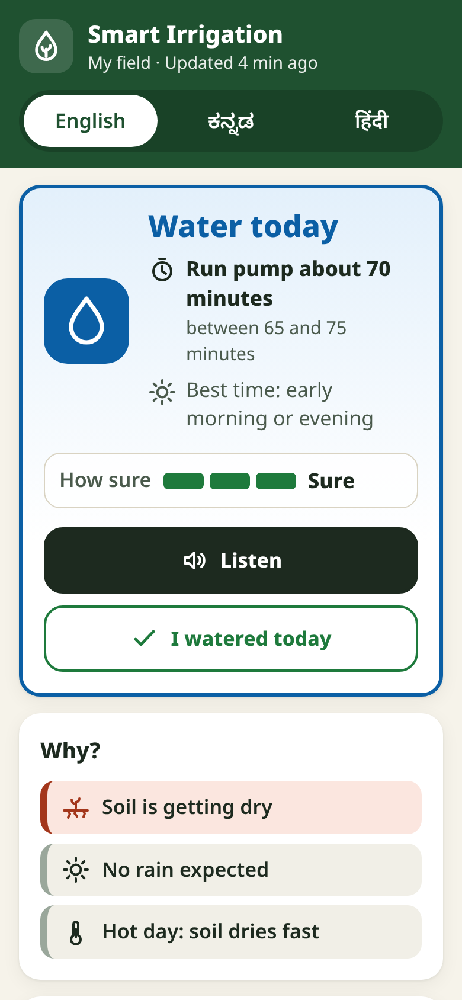
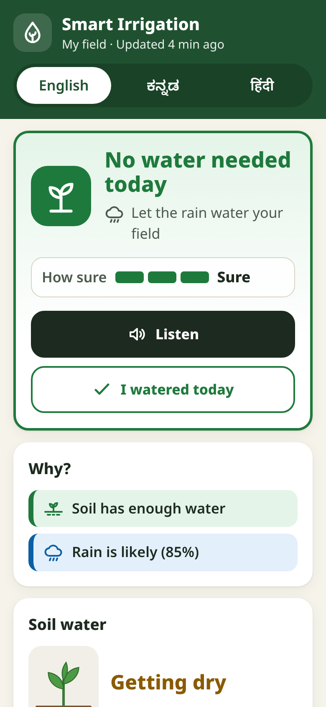
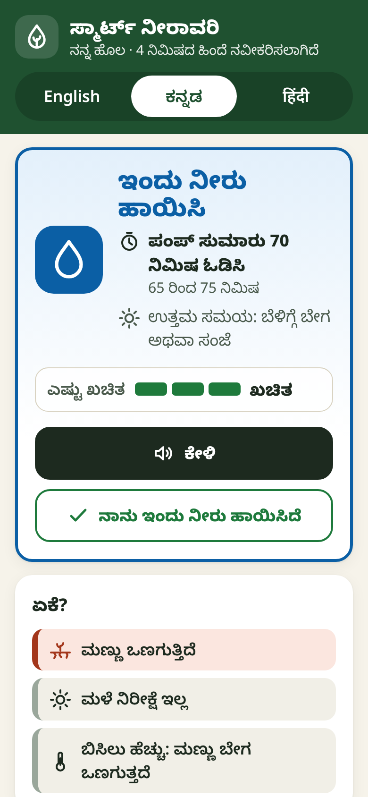
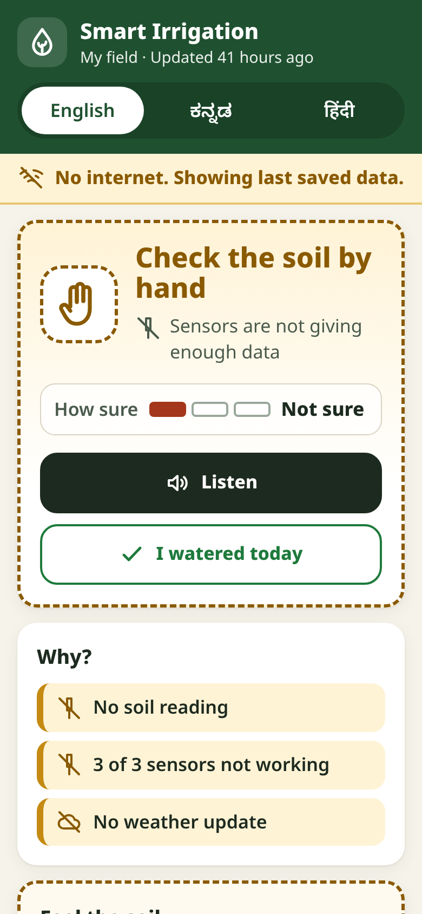
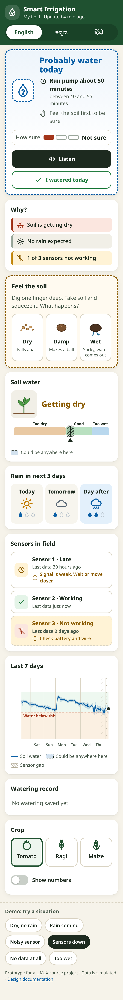
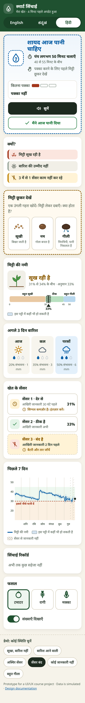

# Smart Irrigation Decision Dashboard

**UI/UX project · Domain: Agriculture**
**Student:** Ritesh Vinod (1EP24CS120) · Problem no. 49

> **Problem statement:** Design a dashboard from soil and weather sensors that helps a smallholder farmer decide **when to irrigate**, even when sensor data is **noisy or missing**.
>
> **Core challenges:** uncertainty display · low literacy · data gaps



---

## 1. What it does

The dashboard answers **one question**: *"Should I water my field today?"*

| Instead of… | The farmer sees… |
|---|---|
| Raw sensor numbers and graphs | One big answer with an icon: **Water today**, **Probably water today**, **No water needed today** or **Check the soil by hand** |
| "Volumetric water content 27.4 ± 1.8 %" | A plant picture (healthy / wilting / waterlogged), a coloured soil bar with a **"could be anywhere here"** band, and the word *Too dry* |
| Statistical confidence | A 3-segment **"How sure"** meter: *Sure* / *Fairly sure* / *Not sure* |
| Error codes when a sensor fails | "Sensor 3 · Not working · *Check battery and wire*", plus a **"Feel the soil"** hand test the farmer can do instead |
| Text-only UI | Icons on everything, **voice read-out** (Listen button), and **English / ಕನ್ನಡ / हिंदी** |

## 2. How the three core challenges are solved

### Uncertainty display
- **Confidence meter** (3 segments + word) on the main answer. Fewer filled segments = less sure; colour changes too, but the segment count and word carry the meaning without colour.
- **Hedged wording** when unsure: "Probably water today" instead of "Water today", with a dashed (not solid) card border.
- **Ranges, not single numbers**: "Run pump about 50 minutes (between 40 and 55)".
- **Uncertainty band** on the soil gauge and on the 7-day chart ("Could be anywhere here").
- Data problems **cap confidence**: if any sensor is broken or noisy, or there is no forecast, the app is never allowed to say "Sure".

### Low literacy
- One decision at the top, details below (progressive disclosure).
- Every status = **icon + colour + short word** (never colour alone).
- **Listen** button reads the advice aloud in the chosen language (Web Speech API).
- **Picture mode by default**: percentages are hidden until "Show numbers" is switched on.
- Large text (18 px base) and touch targets of 56 px. Crop is chosen by picture, not by typing.
- Local languages: Kannada and Hindi, written in short, everyday words.

### Data gaps
- The engine **cleans** readings: impossible values (0 %, 99 %) and spikes are removed with a median/MAD filter.
- It **fuses** all sensors, giving less weight to noisy or old ones, and widens the uncertainty when sensors disagree or data is old.
- Gaps show up on the chart as **hatched "No data" areas** instead of a line drawn through them.
- **Sensor health list** says which sensor is broken and what to do about it.
- With **no usable data**, the app says so and asks the farmer to **feel the soil** (Dry / Damp / Wet picture buttons). That answer is used as an extra, less exact sensor.
- **Offline**: a banner says "No internet. Showing last saved data", and a service worker keeps the app working without signal.
- "I watered today" overrides old sensor data so the advice doesn't repeat itself.

## 3. Try it

**Live (GitHub Pages):** open `smart-irrigation-dashboard/index.html` from the repository's Pages site.
**Locally:** download the repository and double-click `smart-irrigation-dashboard/index.html`. There is nothing to install or build.

Use the **"Demo: try a situation"** buttons at the bottom of the page to switch between simulated conditions:

| Scenario | What happens |
|---|---|
| Dry, no rain | **Water today**, Sure, pump time range shown |
| Rain coming | **No water needed today**, "Let the rain water your field" |
| Noisy sensor | Spikes are filtered out; answer is still given, but only *Fairly sure* |
| Sensors down | **Probably water today**, *Not sure*; "Feel the soil" moves up the page |
| No data at all | **Check the soil by hand**; offline banner; no forecast |
| Too wet | **No water needed today**; waterlogged plant picture |

You can also link to a scenario directly: `index.html?scenario=offline`.

## 4. Screenshots

| Water today (mobile) | Rain coming | Kannada |
|---|---|---|
|  |  |  |

| No data at all | Sensors down (full page) | Hindi + numbers on |
|---|---|---|
|  |  |  |

## 5. Project structure

```
smart-irrigation-dashboard/
├── index.html          Page structure (semantic sections, ARIA labels)
├── css/styles.css      Design tokens, layout, components
├── js/
│   ├── i18n.js         English / Kannada / Hindi text
│   ├── icons.js        Inline SVG icon set (works offline)
│   ├── data.js         Simulated sensor + weather data (6 scenarios)
│   ├── engine.js       Decision engine: cleaning, fusion, uncertainty, decision
│   └── app.js          Rendering, voice, storage, interactions
├── sw.js, manifest.json  Offline support / installable on phone
└── docs/
    ├── DESIGN.md       Full UX case study (research → persona → flows → wireframes → UI → evaluation)
    ├── USABILITY-TEST.md  Test plan, tasks and scoring sheet
    └── screenshots/
```

## 6. Design documentation

Read the full UX process in **[docs/DESIGN.md](docs/DESIGN.md)**: problem analysis, persona, user journey, information architecture, wireframes, design system, decision logic, heuristic evaluation and accessibility checklist.
The usability test plan is in **[docs/USABILITY-TEST.md](docs/USABILITY-TEST.md)**.

## 7. Technology

Plain HTML, CSS and JavaScript, with no frameworks and no build step, so it loads quickly on cheap phones and slow networks. All data is simulated. In a real deployment, `data.js` would be replaced by readings from the field sensor gateway and a weather API (for example IMD).
