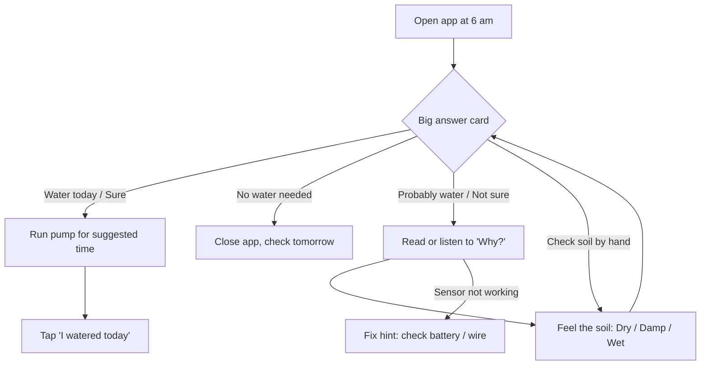
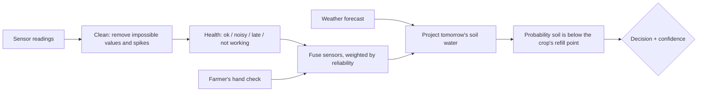

# Design Documentation: Smart Irrigation Decision Dashboard

Ritesh Vinod · 1EP24CS120 · UI/UX project no. 49 · Domain: Agriculture

This document follows the design-thinking process: **Empathise → Define → Ideate → Prototype → Test**.

---

## 1. Empathise: understanding the problem

### 1.1 Context
- Most Indian farms are small: smallholders farm on less than 2 hectares.
- Many use a borewell pump and drip or furrow irrigation. Electricity for the pump is often available only at certain hours.
- Low-cost soil-moisture sensors are cheap but **unreliable**. They drift, give spikes when the wire is loose, lose radio packets, and die when the battery runs out.
- Mobile internet in the field is patchy.
- Users may read their own language slowly or not at all, and are usually not used to charts.

### 1.2 What goes wrong today
| Problem | Effect |
|---|---|
| Farmers water by habit or a fixed calendar | Wasted water and electricity, root rot, nutrients washed away |
| Sensor apps show raw numbers (e.g. "VWC 27.4 %") | The farmer doesn't know if 27 is good or bad |
| Apps show a confident answer from bad data | The farmer gets wrong advice, loses trust and stops using the app |
| A sensor fails silently | The chart shows a flat line or zero, which the farmer reads as "dry" |

### 1.3 Assumptions and research inputs
This is a course prototype. The user insights below come from secondary sources (agricultural extension material, published guidance on soil-moisture sensors, ICT4D design guidance on low-literacy users) and from common knowledge of smallholder practice. **They were not tested with real farmers.** Section 7 has a plan for that.

Key insights:
1. **Farmers already know the hand-feel test** (squeeze the soil). It is trusted and costs nothing, so it should be part of the design.
2. **Voice and pictures beat text** for low-literacy users. Icons must be concrete (a plant, a drop of water), not abstract symbols.
3. **Trust is fragile.** One confident wrong answer can make a farmer stop using a tool. Admitting "I am not sure" builds trust.
4. **The decision is binary and daily**: water today or not, and for how long.

---

## 2. Define

### 2.1 Persona

> **Manjunath, 46, tomato and ragi farmer near Kolar, Karnataka**
> - 1.5 acres, borewell + drip lines, three-phase power available 6 am – 12 pm
> - Studied up to class 5. Reads Kannada slowly, doesn't read English
> - Uses a basic Android phone mostly for WhatsApp voice notes and YouTube
> - Bought 3 soil sensors through a farmer cooperative scheme
>
> **Goal:** "Tell me if I should start the pump today, and for how long."
> **Frustrations:** "The app shows numbers I don't understand." "Last week it said 0 % water, so I watered, but the sensor was just broken."
> **Context of use:** standing in the field at 6 am, phone in one hand, bright sun, weak signal.

### 2.2 Secondary user
**Lakshmi, 34, Manjunath's daughter-in-law.** She reads Hindi and English and sometimes helps manage the field. She wants to see numbers and history, so the design includes a "Show numbers" option.

### 2.3 Problem statement (point of view)
*Manjunath needs a **clear, trustworthy daily watering decision** that he can understand **without reading numbers**, because his sensors are **often noisy or offline** and a wrong confident answer wastes water and makes him stop trusting the tool.*

### 2.4 "How might we" questions
- HMW show **how sure** the advice is without statistics?
- HMW keep giving useful advice when **sensors fail**?
- HMW make the dashboard usable by someone who **can't read well**?
- HMW use what the farmer **already knows** (hand-feel test) as data?

### 2.5 Success criteria
| Goal | Measure |
|---|---|
| Understand today's decision | Correct answer to "should you water today?" within 10 seconds |
| Understand uncertainty | User can say whether the app is sure or not sure |
| Recover from a data gap | User finds and uses "Feel the soil" when sensors are down |
| Low literacy | Tasks completed with voice + icons only |

---

## 3. Ideate

### 3.1 Concepts considered
| Concept | Pros | Cons | Decision |
|---|---|---|---|
| A. Classic analytics dashboard (graphs for each sensor) | Complete data | Needs data literacy; no clear answer | ❌ Rejected |
| B. Traffic light only (red / green) | Very simple | Hides uncertainty and data problems; colour-blind issues | ❌ Rejected |
| C. **Decision first + reasons + layers of detail** | Clear answer, honest about uncertainty, details available | Needs careful wording | ✅ Chosen |
| D. SMS / IVR voice call only | No smartphone needed | No visual history; hard to prototype | Future work (Section 8) |

### 3.2 Design principles
1. **Answer first.** The decision is the biggest thing on screen.
2. **Be honest about doubt.** Every answer comes with how sure it is, and the reason.
3. **Never colour alone.** Each status uses colour + icon + word + shape (solid vs. dashed border).
4. **Pictures before numbers.** Numbers are opt-in.
5. **Always offer a next step.** Even with no data, tell the farmer what to do ("Feel the soil", "Check battery and wire").
6. **Speak the user's language**, both literally (Kannada / Hindi + voice) and in tone (short everyday words).

---

## 4. Information architecture and user flow

### 4.1 Content priority (top to bottom on mobile)
1. **Decision card**: answer, pump time, how sure, Listen, "I watered today"
2. **Why?**: 2–5 reason chips with icons
3. **Feel the soil**: moves up to position 3 when the app is unsure or has no data
4. **Soil water**: plant picture + gauge with uncertainty band
5. **Rain in next 3 days**
6. **Sensors in field**: health and fix-it hints
7. **Last 7 days** chart
8. **Watering record**
9. **Crop + Show numbers** settings

### 4.2 User flow



### 4.3 Decision logic (engine.js)



- **Cleaning:** values outside 1–60 % are physically impossible and are dropped. Outliers are removed with a median ± 3·MAD rule.
- **Health:** no data for 36 h or more = *Not working*; 6–36 h = *Late*; spikes or high variance = *Unsteady*.
- **Fusion:** inverse-variance weighted mean. Uncertainty grows with sensor noise, data age (soil keeps drying while we can't see it) and disagreement between sensors. A single remaining source can never be very certain.
- **Hand check:** Dry ≈ 22 %, Damp ≈ 34 %, Wet ≈ 46 %, each with ±5 % uncertainty, valid for 24 h.
- **Projection:** daily drying depends on temperature; expected rain is weighted by its probability. With no forecast, the app uses a cautious default and widens the uncertainty.
- **Decision:** `P(dry) = Φ((refill − projected) / uncertainty)`.
  - P(dry) ≥ 0.5 and no heavy rain coming → **Water** (or **Probably water** if confidence is low)
  - Otherwise → **Wait**
  - No usable data → **Check the soil by hand**
- **Confidence:** `max(P, 1−P)` of 0.85 or more = Sure, 0.65 or more = Fairly sure, otherwise Not sure. Capped at "Fairly sure" if any sensor is broken or noisy, or the forecast is missing.

---

## 5. Prototype

### 5.1 Low-fidelity wireframe (mobile)

```
┌─────────────────────────────┐
│ 💧 Smart Irrigation  EN|ಕ|हि │  ← language always visible
│ My field · updated 4 min ago │
├─────────────────────────────┤
│ ┌───┐  WATER TODAY           │  ← decision (largest text)
│ │ 💧│  ⏱ Pump ~50 min (40–55) │
│ └───┘  ☀ Early morning/evening│
│ How sure  ■■□  Fairly sure   │  ← confidence meter
│ [ 🔊 Listen ] [✓ I watered ] │
├─────────────────────────────┤
│ Why?                         │
│ ▌🌱 Soil is getting dry      │  ← reason chips
│ ▌☀ No rain expected          │
│ ▌⚠ 1 of 3 sensors not working│
├─────────────────────────────┤
│ Feel the soil (if unsure)    │
│ [ ∴ Dry ][ ● Damp ][ ●≈ Wet ]│
├─────────────────────────────┤
│ Soil water   🌿 Getting dry  │
│ [dry▓▓▓▓▒▒|▒good▒▒|wet ]     │  ← band = "could be anywhere here"
│        ▲                      │
├─────────────────────────────┤
│ Rain: Today ☀ · Tmrw ☁ · ⛆   │
├─────────────────────────────┤
│ Sensors: ✓ 1 · ⏱ 2 · ✗ 3     │
├─────────────────────────────┤
│ Last 7 days  ~~~~░░░~~~       │  ← ░ = no-data gap
└─────────────────────────────┘
```

On desktop and tablet the same cards sit in a 2–3 column grid, with the decision and the chart spanning the full width.

### 5.2 Visual design system

| Token | Value | Use |
|---|---|---|
| `--brand` | `#1f5130` deep green | Top bar, selected states |
| `--water` | `#0b5fa5` blue | "Water" decision, rain |
| `--good` | `#1e7a3c` green | "No water needed", sensor OK, Sure |
| `--warn` | `#8a5a00` amber | Data problems, "Check by hand" |
| `--bad` | `#a3361b` brick red | Too dry, Not sure |
| `--bg` | `#f6f3ea` warm off-white | Page background (less glare than pure white) |

- **Typography:** Noto Sans / Noto Sans Kannada / Noto Sans Devanagari, so the three scripts look consistent. Base size 18 px, decision 28–38 px, weight 800 for headings.
- **Shape language:** solid border = confident; **dashed border** = uncertain (Probably water, Check by hand, broken sensor, uncertainty band). This repeats one visual idea throughout the app.
- **Touch targets:** at least 44 px, main buttons 56 px.
- **Light theme only, on purpose:** the app is used outdoors in bright sun, where a light, high-contrast theme is easier to read than a dark one.
- **Icons:** custom inline SVG, concrete objects (drop, plant, sun, rain cloud, hand, sensor stick), with no emoji, so they look the same on every phone.

### 5.3 Key screens
See `screenshots/`:
- `mobile-water.png`: confident "Water today"
- `mobile-rain-wait.png`: rain forecast overrides dry soil
- `mobile-noisy.png`: noisy sensor, answer given at "Fairly sure"
- `mobile-sensors-down.png`: "Probably water", "Feel the soil" moves up
- `mobile-no-data.png`: offline, no sensors, "Check the soil by hand"
- `mobile-kannada.png`, `mobile-hindi-numbers.png`: localisation and numbers mode
- `desktop-water.png`: wide layout

---

## 6. Evaluation

### 6.1 Heuristic evaluation (Nielsen's 10)

| # | Heuristic | How the design meets it |
|---|---|---|
| 1 | Visibility of system status | "Updated 4 min ago", offline banner, sensor health list, data age shown in reasons |
| 2 | Match with the real world | Farmer's words (pump minutes, not mm of water); hand-feel test; plant pictures; local languages |
| 3 | User control and freedom | Undo after "I watered today"; "Remove my check"; language switch always visible |
| 4 | Consistency and standards | Same colour + icon + border style for each status everywhere |
| 5 | Error prevention | Never gives a confident answer from bad data; cleans impossible values before using them |
| 6 | Recognition rather than recall | Picture buttons for crop and soil feel; nothing has to be typed |
| 7 | Flexibility and efficiency | Picture mode for Manjunath, "Show numbers" for Lakshmi |
| 8 | Aesthetic and minimalist design | One answer at the top; details further down; no decorative charts |
| 9 | Help users recover from errors | Each broken sensor has a fix hint ("Check battery and wire") |
| 10 | Help and documentation | "Why?" reasons explain every answer; Listen reads it aloud |

### 6.2 Accessibility checklist (WCAG 2.1 AA)
- [x] Text contrast ≥ 4.5:1 for all body text on its background
- [x] Status never shown by colour alone (icon + word + border style)
- [x] All controls are real `<button>` / `<input>` elements, so they work with the keyboard and show a visible focus ring
- [x] `aria-live` on the decision card, so screen readers announce changes
- [x] `aria-pressed` on toggle buttons; `role="img"` + labels on meters and charts
- [x] `lang` attribute changes with the selected language (correct screen-reader voice)
- [x] Skip link to the main advice
- [x] Respects `prefers-reduced-motion`
- [x] Usable at 320 px width; text can be zoomed to 200 %

### 6.3 Usability testing
See **[USABILITY-TEST.md](USABILITY-TEST.md)** for the test plan, tasks and scoring sheet. Usability testing with real farmers has not been carried out yet. The plan is written so it can be run with 5 participants.

---

## 7. Limitations
- All data is **simulated**. The thresholds (refill point, pump minutes per %) are illustrative and need calibration per soil type with an agronomist.
- Kannada and Hindi text was written for this prototype and should be checked by native speakers in the target region.
- Voice output depends on the phone having a Kannada or Hindi text-to-speech voice installed.
- No real users have tested it yet (see Section 6.3).

## 8. Future work
- **IVR / missed-call service** and SMS for farmers without smartphones
- **Pump-schedule awareness**: fit the advice to the hours when power is available
- **Push notification** at 6 am with the day's answer
- **Learning from the farmer**: use hand-check results to correct sensor drift over time
- **Cooperative view**: one extension worker watching many farms' sensor health
